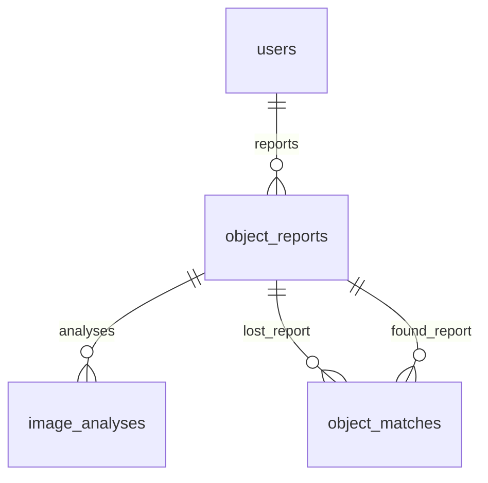

# EncuentraU AI API

API de reconocimiento visual y evaluación de coincidencias entre objetos perdidos
y encontrados, con PostgreSQL, migraciones y autenticación persistente. Usuarios y
reportes y coincidencias generadas se guardan en PostgreSQL, con análisis visual
opcional asociado al reporte.
Analizar una imagen o evaluar una coincidencia por separado no guarda resultados.

## Funciones incluidas

- `GET /health`: comprueba que el servidor está disponible.
- `GET /health/database`: comprueba la conexión con PostgreSQL.
- `POST /api/v1/auth/register`: registra un estudiante activo en PostgreSQL.
- `POST /api/v1/auth/login`: valida credenciales y entrega un JWT.
- `GET /api/v1/auth/me`: consulta al usuario autenticado.
- CRUD JWT de reportes propios en `/api/v1/reports`.
- `POST /api/v1/ai/analyze`: recibe una fotografía y una descripción.
- `POST /api/v1/matches/evaluate`: compara dos objetos y devuelve evidencias.
- `POST /api/v1/reports/{report_id}/matches/generate`: genera coincidencias persistentes.
- `GET /api/v1/matches/me`: lista coincidencias propias con paginación y filtros.
- `GET /api/v1/matches/{match_id}`: consulta una coincidencia como participante.
- Validación de JPEG, PNG y WEBP.
- Límite configurable de tamaño.
- Análisis con Gemini mediante el SDK oficial `google-genai`.
- Respuesta JSON validada con Pydantic.
- Pruebas automáticas que no consumen la API de Gemini.

## 1. Preparar el entorno

Desde la raíz del repositorio `EncuentraU_Backend`:

```bash
python -m venv .venv
```

En Windows PowerShell:

```powershell
.\.venv\Scripts\Activate.ps1
pip install -r requirements-dev.txt
```

En Linux o macOS:

```bash
source .venv/bin/activate
pip install -r requirements-dev.txt
```

## 2. Configurar Gemini

1. Crea una clave gratuita en Google AI Studio.
2. Solo si no existe `.env`, copia `.env.example` como punto de partida. Si ya
   existe, conserva su contenido y agrega manualmente las variables faltantes.
3. Reemplaza el valor de `GEMINI_API_KEY`.

El archivo `.env` está ignorado por Git y no debe publicarse.

## 3. Ejecutar

```bash
uvicorn app.main:app --reload --port 8000
```

Abre:

```text
http://127.0.0.1:8000/docs
```

En `POST /api/v1/ai/analyze`, selecciona **Try it out**, escribe la descripción,
elige una fotografía y ejecuta la petición.

## 4. Ejecutar pruebas

```bash
pytest
ruff check .
```

Las pruebas utilizan un analizador falso para verificar el endpoint y el contrato
JSON sin consumir cuota de Gemini.

## Contrato de salida

```json
{
  "object_detected": true,
  "object_type": "audifonos inalambricos",
  "category": "electronica",
  "primary_color": "negro",
  "secondary_colors": [],
  "brand": null,
  "shape": "intraurales con estuche rectangular",
  "visible_features": ["estuche negro"],
  "visible_text": [],
  "image_quality": "buena",
  "confidence": "alta",
  "requires_another_photo": false,
  "warnings": []
}
```

La confianza es orientativa. El usuario siempre podrá confirmar o corregir los
atributos antes de guardarlos.

## Motor de coincidencias

`POST /api/v1/matches/evaluate` recibe JSON con `lost` y `found`. Conserva el
contrato de entrada anterior. Los atributos de cada objeto son opcionales; si no
son comparables, se marcan como `unknown` y se excluyen del máximo evaluable.
Los valores vacíos y marcadores como `desconocido`, `sin marca` y `no visible`
tampoco son evidencia. Se rechazan campos adicionales y fechas inválidas con
HTTP 422.

Ejemplo para Postman (`Content-Type: application/json`):

```json
{
  "lost": {
    "object_type": "audífonos Bluetooth",
    "category": "electronica",
    "primary_color": "negro",
    "secondary_colors": [],
    "brand": "JBL",
    "shape": "estuche ovalado",
    "visible_features": ["audífonos intraurales", "estuche compacto", "puerto USB-C"],
    "visible_text": ["JBL"],
    "location": "Cafetería central",
    "event_date": "2026-09-01",
    "description": "Audífonos Bluetooth negros en estuche ovalado compacto."
  },
  "found": {
    "object_type": "auriculares inalámbricos",
    "category": "electronica",
    "primary_color": "negro",
    "secondary_colors": [],
    "brand": "JBL",
    "shape": "estuche ovalado",
    "visible_features": ["audífonos intraurales", "estuche compacto", "puerto USB-C"],
    "visible_text": ["JBL"],
    "location": "Cafetería central",
    "event_date": "2026-09-01",
    "description": "Audífonos inalámbricos negros en estuche ovalado compacto."
  }
}
```

El ejemplo devuelve este resumen, además de nueve `factors` y `warnings`:

```json
{
  "percentage": 100,
  "identity_percentage": 100,
  "context_percentage": 100,
  "evidence_coverage": 95.2,
  "compatible": true,
  "level": "high"
}
```

### Modelo jerárquico

La identidad aporta el 80% del resultado y el contexto aporta el 20%. Los pesos
internos de cada grupo suman 100:

| Grupo | Factor | Peso interno |
| --- | --- | ---: |
| Identidad | Tipo de objeto | 25 |
| Identidad | Categoría | 5 |
| Identidad | Color | 15 |
| Identidad | Marca | 10 |
| Identidad | Forma | 10 |
| Identidad | Rasgos visuales | 20 |
| Identidad | Descripción del objeto | 15 |
| Contexto | Lugar | 60 |
| Contexto | Fecha | 40 |

```text
identity_percentage = puntos_identidad / peso_identidad_evaluable × 100
context_percentage = puntos_contexto / peso_contexto_evaluable × 100
percentage = identity_percentage × 0,80 + context_percentage × 0,20

evidence_coverage = (peso_identidad_evaluable / 100 × 0,80
                  + peso_contexto_evaluable / 100 × 0,20) × 100
```

Un grupo sin evidencia tiene porcentaje cero; su participación no se transfiere
al otro grupo. `percentage` se redondea al entero más cercano al terminar el
cálculo. Identidad, contexto y cobertura se devuelven con hasta dos decimales.
Los puntos de cada factor se conservan con dos decimales y son los que se usan
para calcular los porcentajes de los grupos. Es una puntuación de evidencias,
no una probabilidad calibrada de que se trate del mismo objeto.

La cobertura indica cuánto del modelo pudo evaluarse, independientemente del
resultado de las comparaciones. Por ejemplo, si solo falta la marca, la
identidad tiene 90 puntos evaluables y el contexto 100: la cobertura es 92%.
Una marca distinta y legible aporta cero puntos, pero sí entra en el denominador.

Cada factor contiene `name`, `group` (`identity` o `context`), `label`, `weight`,
`evaluable_weight`, `score`, `status` y `explanation`. `weight` es su peso interno
máximo; `evaluable_weight` indica cuánto se pudo comparar. `score` representa
puntos dentro del grupo, no una contribución directa al porcentaje final.
Los estados siguen siendo `match`, `partial`, `different` y `unknown`.

### Reglas de comparación

- Las comparaciones por palabras usan intersección dividida por unión (Jaccard).
  Se normalizan mayúsculas, tildes y puntuación, y se omiten artículos y
  preposiciones. Hay equivalencias explícitas para singular/plural y variantes
  como auriculares/audífonos, Bluetooth/inalámbricos, copa/copas,
  almohadilla/almohadillas y acolchado/acolchada/acolchados/acolchadas.
- Categoría y marca requieren igualdad del texto normalizado.
- El color principal representa el 60% del factor; los conjuntos de colores
  secundarios se comparan con Jaccard para el 40% restante. Si los secundarios
  no se pueden comparar, solo se evalúan los 9 puntos del principal. Si solo
  se conocen los secundarios, se evalúan sus 6 puntos. Los componentes ausentes
  reducen la cobertura y no se registran como diferencias. Por eso el ejemplo
  anterior, sin secundarios comparables, tiene cobertura de 95,2%. Dos conjuntos
  secundarios conocidos y disjuntos generan una advertencia.
- La forma tiene su propio factor. Los rasgos y el texto visible se comparan
  como características independientes: cada una busca su mejor correspondencia
  por palabras en el otro objeto y se promedian ambas direcciones. Se eliminan
  duplicados y se conserva la simetría; juntar palabras de distintos atributos
  no equivale a describir el mismo rasgo.
- La descripción excluye los tokens de ambos lugares y palabras de reporte
  como perdí, perdido, encontré, encontrado, hallado y extraviado, con sus
  variantes. Una descripción que solo contiene esos datos queda como `unknown`.
- El lugar usa similitud de palabras. La fecha aporta 100% si es el mismo día;
  75% entre 1 y 3 días después; 50% entre 4 y 7; 25% entre 8 y 14. Un hallazgo
  anterior a la pérdida o posterior a los 14 días aporta cero y sigue siendo
  evaluable. Las fechas invertidas generan una advertencia.

### Compatibilidad y niveles

Si la similitud del tipo de objeto es menor a 0,35, `compatible` es `false`, se
añade una advertencia y el porcentaje se limita a 29, con nivel `low`. Los
porcentajes de identidad y contexto conservan sus valores para explicar el
resultado anterior al límite. El mismo lugar y fecha no pueden superar esta
regla.

Si el tipo no se puede comparar, no se afirma una incompatibilidad: `compatible`
indica ausencia de incompatibilidad conocida. La falta de tipo se muestra en
los factores, las advertencias y la cobertura. Una cobertura reducida requiere
interpretar el porcentaje con esa limitación.

Los niveles usan el porcentaje final redondeado:

- `high`: al menos 85 y compatible.
- `possible`: al menos 60 y compatible.
- `low`: cualquier otro caso.

Las pruebas de `tests/fixtures/matching/` conservan los tres cuerpos originales
obtenidos de los análisis de Gemini: mismo objeto desde otro ángulo, objeto
parecido y objeto diferente. En todos se fijó deliberadamente el mismo lugar y
la fecha `2026-10-16`. Las pruebas reproducen esas entradas sin enviar imágenes
ni consumir nuevas llamadas a Gemini.

Para comparar análisis reales, copia únicamente los atributos del objeto desde
`/api/v1/ai/analyze` y añade `location`, `event_date` y `description` del reporte.
Los metadatos `object_detected`, `image_quality`, `confidence`,
`requires_another_photo` y `warnings` no forman parte de `MatchableObject`.
Si Gemini no detecta un objeto o pide otra foto, revisa el análisis antes de
evaluar coincidencias. Las pruebas del motor usan datos controlados y no validan
el reconocimiento de fotografías reales.

## Base técnica de PostgreSQL

La infraestructura está en `app/infrastructure/database/`: base declarativa,
modelos SQLAlchemy 2, engine con psycopg 3 y fábrica de sesiones. El dominio no
importa SQLAlchemy. El engine y las sesiones se crean bajo demanda; importar la
aplicación no abre conexiones ni crea tablas automáticamente.

La dependencia `get_session` entrega una sesión por petición y siempre la cierra,
también ante excepciones. El cierre revierte trabajo sin confirmar. El repositorio
de usuarios confirma cada registro de forma atómica y ejecuta rollback si falla.

### Tablas y relaciones

| Tabla | Contenido y restricciones |
| --- | --- |
| `users` | UUID; nombre; email y código estudiantil únicos; hash de contraseña, rol, estado activo y fechas de creación/actualización. |
| `object_reports` | UUID; propietario, tipo `lost/found`, estado, atributos del objeto, descripción, lugar, fecha y característica privada. |
| `image_analyses` | UUID; reporte, proveedor, modelo, extracción JSONB, confianza y fecha de creación. |
| `object_matches` | UUID; pareja lost/found única, métricas, compatibilidad, nivel, factores JSONB, advertencias JSONB, estado y fecha de creación. |



Todos los identificadores son UUID generados por la aplicación. Las fechas de
auditoría usan timestamps con zona horaria y valor inicial del servidor.
`updated_at` se actualiza mediante SQLAlchemy al modificar un registro; una
actualización SQL externa debe mantenerlo explícitamente.

Los porcentajes están limitados a 0–100. Las métricas de identidad, contexto y
cobertura tienen dos decimales. Una pareja no puede relacionar un reporte
consigo mismo; si `compatible` es falso, el nivel debe ser `low` y el porcentaje
no puede superar 29. Las claves foráneas garantizan la existencia de los reportes;
la validación de que cada uno tenga el tipo lost/found correcto queda para los
futuros casos de uso persistentes.

No se permite borrar un usuario con reportes. Al borrar un reporte se eliminan
sus análisis y coincidencias mediante claves foráneas con `ON DELETE CASCADE`.
Los atributos visuales desconocidos y `private_feature` admiten NULL.
No hay columnas binarias ni almacenamiento de fotografías; las referencias a
imágenes se añadirán en una fase posterior.

Decisiones iniciales de estados:

- Roles: `student`, `admin`.
- Reportes: `active`, `resolved`, `cancelled`.
- Coincidencias: `pending`, `accepted`, `rejected`.
- Confianza visual: `baja`, `media`, `alta`, como en el contrato de Gemini.

La unicidad de email y código se aplica sobre sus valores almacenados. El registro
normaliza email a minúsculas y código a mayúsculas antes de consultar y guardar.
Las escrituras SQL externas deben respetar esa misma normalización.

### Configuración local

Agrega manualmente estas variables a tu `.env` existente, usando `.env.example`
como referencia y conservando las variables de Gemini:

- `POSTGRES_DB`
- `POSTGRES_USER`
- `POSTGRES_PASSWORD`
- `POSTGRES_PORT`
- `DATABASE_URL`

El ejemplo contiene únicamente valores de muestra. `DATABASE_URL` debe apuntar
al mismo usuario, contraseña, puerto y base definidos para Docker, con el esquema
`postgresql+psycopg`. También se acepta `postgresql` y se selecciona psycopg 3.
Si la contraseña contiene caracteres reservados, debe codificarse para una URL.

La URL se guarda como `SecretStr`, se oculta en la representación de Settings y
los errores de configuración no imprimen sus valores. El engine desactiva el
registro de SQL y oculta parámetros. No imprimas la URL ni la configuración
expandida de Compose.

Antes de iniciar el servicio, comprueba que Docker y su daemon estén disponibles:

```powershell
docker version
docker compose version
docker compose config --quiet
docker compose up -d --wait
python -m alembic upgrade head
```

El Compose usa PostgreSQL 17, publica el puerto únicamente en `127.0.0.1`, obtiene
variables de `.env`, incorpora un healthcheck y conserva los datos en el volumen
nombrado `postgres_data`. Las variables de inicialización de PostgreSQL solo se
aplican al crear un volumen vacío; cambiarlas después no modifica las credenciales
de una base existente. La imagen y su configuración se describen en la
[documentación oficial de PostgreSQL para Docker](https://hub.docker.com/_/postgres).

La revisión inicial de Alembic es `0001_postgresql_foundation`. Crea las cuatro
tablas, índices, claves y restricciones; no depende de `create_all` ni de las
credenciales incluidas en un archivo versionado. Alembic utiliza la configuración
en memoria y no escribe `DATABASE_URL` en `alembic.ini`.

Si PowerShell bloquea la activación del entorno, usa directamente
`.\.venv\Scripts\python.exe` en lugar de `python`, sin cambiar la política del
sistema. Reinicia Uvicorn después de configurar las variables.

### Disponibilidad y pruebas

`GET /health/database` ejecuta `SELECT 1`: devuelve HTTP 200 con
`{"status":"ok","database":"postgresql"}` o HTTP 503 con
`{"detail":"La base de datos no está disponible."}`. Si `DATABASE_URL` no está
configurada, devuelve 503; `/health`, `/api/v1/ai/analyze` y
`/api/v1/matches/evaluate` mantienen su funcionamiento independiente.

```powershell
python -m ruff format .
python -m ruff check .
python -m pytest
```

Las pruebas no cargan `.env`. Las pruebas unitarias de metadatos y restricciones
usan SQLite en memoria, y también generan SQL de PostgreSQL sin conectarse.
Para ejecutar la integración real, define `TEST_DATABASE_URL` únicamente en el
entorno del proceso, apuntando a una base de prueba PostgreSQL, y ejecuta:

```powershell
python -m pytest -m postgresql
```

La integración crea un esquema con UUID, aplica y revierte migraciones, vuelve
a aplicarlas, verifica ausencia de cambios pendientes de Alembic, prueba
restricciones y JSONB, registra un usuario, inicia sesión y consulta `/auth/me`.
También comprueba el health real. Solo elimina el esquema que
acaba de crear. Requiere permisos para crear esquemas en esa base de prueba.
Si la variable no está definida, esa prueba se omite de forma explícita.

## Autenticación persistente

Se usan `pwdlib[argon2]` y PyJWT siguiendo la
[guía oficial de seguridad de FastAPI](https://fastapi.tiangolo.com/tutorial/security/oauth2-jwt/).
El login recibe JSON, por lo que la documentación interactiva utiliza el esquema
HTTP Bearer: después del login pega el token en **Authorize**.

### Arquitectura y transacciones

- Dominio: entidad `User`, roles, normalizadores, errores y puertos de repositorio,
  hash y tokens; no importa FastAPI ni SQLAlchemy.
- Aplicación: casos de uso `RegisterUser`, `LoginUser` y `GetCurrentUser`.
- Infraestructura: repositorio SQLAlchemy, hash Argon2id con sal aleatoria y
  adaptador JWT. El registro hace commit; cualquier error de escritura revierte
  la transacción. Las restricciones únicas resuelven también registros concurrentes.
- API: schemas explícitos sin hash, dependencias y rutas. Una sesión por petición
  se cierra al terminar, incluidos los errores; no se devuelven entidades ORM.

No hay cambios de estructura ni migración `0002`: la revisión
`0001_postgresql_foundation` ya contiene los campos y restricciones necesarios y
permanece intacta. `alembic upgrade head` conserva la información existente.

### Configuración JWT manual

Conserva las variables existentes de Gemini y PostgreSQL y añade manualmente:

```ini
JWT_SECRET_KEY=<clave-local-generada>
JWT_ALGORITHM=HS256
ACCESS_TOKEN_EXPIRE_MINUTES=60
```

Genera una clave aleatoria local de 32 bytes (64 caracteres hexadecimales):

```powershell
python -c "import secrets; print(secrets.token_hex(32))"
```

Copia esa salida solo a tu `.env` local; no la compartas ni la subas. No utilices
el texto de ejemplo como clave. `JWT_SECRET_KEY` es `SecretStr`, se oculta en la
configuración y debe tener al menos 32 bytes. El único algoritmo admitido es
HS256; la duración debe ser positiva. Reinicia Uvicorn tras configurarlos.
Una clave ausente o vacía devuelve HTTP 503 controlado en login y validación JWT;
el registro y los endpoints anteriores no dependen de la clave JWT.

### Contratos y reglas

`POST /api/v1/auth/register` recibe `full_name`, `email`, `student_code` y
`password`. Devuelve HTTP 201 con `id`, `full_name`, `email`, `student_code`,
`role` e `is_active`. El nombre colapsa espacios; el email se recorta y pasa a
minúsculas; el código se recorta y pasa a mayúsculas. El código admite letras,
dígitos, punto, guion y guion bajo, hasta 50 caracteres. El nombre admite hasta
200 y el email hasta 254. La contraseña admite de 8 a 128 caracteres y conserva
exactamente sus espacios. Solo se almacena el hash Argon2id.

Los campos adicionales (`role`, `is_active`, `password_hash`, etc.) se rechazan
con HTTP 422. Todo registro público crea un usuario `student` activo; no existe
un endpoint público para crear administradores. Email o código duplicados
devuelven HTTP 409. Los errores de validación no incluyen el cuerpo original ni
los valores de los campos.

`POST /api/v1/auth/login` recibe email y contraseña. Devuelve `access_token`,
`token_type: "bearer"`, `expires_in` en segundos y `user` con los mismos campos
públicos del registro. No se guardan tokens en la base. Correo inexistente y
contraseña incorrecta producen el mismo HTTP 401, con `WWW-Authenticate: Bearer`;
el caso inexistente también realiza una verificación de hash ficticio para
reducir diferencias de tiempo. Un usuario inactivo con contraseña correcta
recibe HTTP 403.

El JWT lleva `sub` (UUID), `role`, `iat` y `exp`. Se exige la presencia de los
cuatro campos, firma HS256 válida y vigencia. `GET /api/v1/auth/me` requiere
`Authorization: Bearer <token>` y consulta al usuario en PostgreSQL. Ausencia,
modificación, expiración o usuario eliminado producen HTTP 401; usuario inactivo,
HTTP 403. El rol y estado actuales se consultan en la base, aunque cambien después
de emitir el token. Ni contraseñas, hashes ni tokens se registran en logs; el
token solo se entrega en el contrato de login, con `Cache-Control: no-store`.

### Prueba manual desde PowerShell

Después de configurar las variables, aplicar `python -m alembic upgrade head` y
arrancar `python -m uvicorn app.main:app --reload --host 127.0.0.1 --port 8000`,
ejecuta en otra terminal:

```powershell
$baseUrl = 'http://127.0.0.1:8000/api/v1'
$credential = Get-Credential -UserName 'usuario@universidad.edu.co' -Message 'Contraseña de prueba (mínimo 8 caracteres)'
$plainPassword = $credential.GetNetworkCredential().Password
try {
    $body = @{
        full_name = 'Usuario Prueba'
        email = $credential.UserName
        student_code = '20260001'
        password = $plainPassword
    } | ConvertTo-Json
    $registered = Invoke-RestMethod -Method Post -Uri "$baseUrl/auth/register" -ContentType 'application/json' -Body $body
    $registered | Format-List

    $body = @{ email = $credential.UserName; password = $plainPassword } | ConvertTo-Json
    $session = Invoke-RestMethod -Method Post -Uri "$baseUrl/auth/login" -ContentType 'application/json' -Body $body
    $session.user | Format-List
    $headers = @{ Authorization = "Bearer $($session.access_token)" }
    Invoke-RestMethod -Uri "$baseUrl/auth/me" -Headers $headers | Format-List
} finally {
    Remove-Variable plainPassword, body, session, headers, credential -ErrorAction SilentlyContinue
}
```

No imprimas `$body`, `$headers` ni `$session` completos. El primer comando de
registro inserta un usuario real; si repites el mismo email o código, obtendrás
409. Para verlo en pgAdmin sin consultar hashes:

```sql
SELECT id, full_name, email, student_code, role, is_active, created_at
FROM users
WHERE email = 'usuario@universidad.edu.co';
```

Las pruebas normales de autenticación usan SQLite temporal y Argon2/JWT reales;
no leen `.env`. La integración PostgreSQL es opcional y solo usa
`TEST_DATABASE_URL` en una **base aislada de pruebas**, nunca la base normal:
ejecuta upgrade/downgrade y elimina únicamente su esquema de prueba.

Quedan para fases posteriores la conexión de Flutter a reportes y coincidencias,
recuperación de contraseña, refresh/revocación de tokens, límites de
intentos de login, almacenamiento de imágenes, reclamaciones y chat.

## Reportes persistentes: ejemplos para Postman

Configura variables locales: `base_url=http://127.0.0.1:8000/api/v1`,
`access_token` con el JWT obtenido del login y `report_id` con el UUID del
reporte creado. No exportes tokens. En todas las peticiones selecciona
**Authorization → Bearer Token → {{access_token}}**. POST y PATCH usan
**Body → raw → JSON**.

### Crear: POST {{base_url}}/reports

```json
{
  "report_type": "lost",
  "object_type": "Audífonos Bluetooth",
  "category": "electronica",
  "primary_color": "negro",
  "secondary_colors": ["azul"],
  "brand": "JBL",
  "shape": "Estuche ovalado",
  "description": "Audífonos negros con detalles azules.",
  "location": "Cafetería central",
  "event_date": "2026-10-16",
  "private_feature": "Detalle que solo conoce el propietario",
  "analysis": {
    "extracted_data": {
      "object_detected": true,
      "object_type": "Audífonos Bluetooth",
      "visible_features": ["Estuche ovalado", "Detalle azul"],
      "image_quality": "buena",
      "confidence": "alta"
    },
    "confidence": "alta"
  }
}
```

Devuelve **201**. `analysis` puede omitirse o ser null. `extracted_data` conserva
el JSON recibido y `confidence` usa `baja`, `media` o `alta`, como la
restricción existente en PostgreSQL. El endpoint no vuelve a llamar a Gemini:
recibe un análisis previo. El proveedor se fija en `gemini` y el modelo sale de
`settings.gemini_model`; no se aceptan del cliente. Guardar la extracción no
certifica su procedencia. Se rechazan imágenes binarias, data URIs y rutas locales.
El JSON admite hasta 64 KiB y profundidad 20. No se guardan fotografías.

La respuesta contiene UUID, `user_id`, tipo, estado, atributos, descripción,
lugar, fecha, detalle privado, análisis opcional y fechas de auditoría. El análisis
incluye sus UUID, proveedor, modelo, extracción, confianza y fecha. Reporte y
análisis se guardan en una sola transacción: cualquier fallo revierte ambos.
El propietario siempre sale del JWT y el estado inicial siempre es active;
campos extra como user_id, status o fechas de auditoría devuelven 422.

Los textos se recortan, colapsan espacios y normalizan a Unicode NFC. Tipo,
categoría y colores pasan a minúsculas; los secundarios se deduplican y omiten el
primario. Máximos: tipo 200 caracteres, categoría/color/marca 100, forma 500,
descripción 5000, lugar 300, detalle privado 2000 y 20 colores. Los atributos
opcionales vacíos se guardan como NULL. La fecha no puede ser futura respecto al
día actual del servidor.

### Listar: GET {{base_url}}/reports/me?limit=20&offset=0

Filtros: `report_type=lost|found` y `status=active|resolved|cancelled`.
Límite de 1 a 100, predeterminado 20; offset no negativo. Devuelve **200**:

```json
{"items": [], "total": 0, "limit": 20, "offset": 0}
```

Total cuenta los reportes propios que cumplen los filtros antes de paginar.
Se ordenan por created_at descendente y UUID descendente como desempate.
Los análisis se cargan por lotes, sin consultas por cada reporte. Sin filtro se
incluyen los cancelados. No hay rutas públicas de reportes en esta fase.

### Detalle: GET {{base_url}}/reports/{{report_id}}

Devuelve **200** con el mismo contrato de creación. El detalle privado solo se
expone al propietario. Si existen varios análisis históricos se devuelve el más
reciente, conservando todos en la base.

### Editar: PATCH {{base_url}}/reports/{{report_id}}

```json
{"description": "Descripción actualizada", "brand": null}
```

Devuelve **200**. Se pueden editar atributos, descripción, lugar, fecha, detalle
privado y estado. Solo reportes actualmente activos pueden cambiar; pasar a
resolved o cancelled impide cambios posteriores. Los campos omitidos se
conservan; null solo limpia color primario, marca, forma o detalle privado.
Un body vacío o null en campos obligatorios devuelve 422. UUID, propietario,
tipo lost/found, auditoría y análisis histórico son inmutables. La fila se bloquea
y se comprueba su versión para evitar sobreescribir cambios concurrentes.

### Cancelar: DELETE {{base_url}}/reports/{{report_id}}

Devuelve **204**, sin body. Cambia status a cancelled y actualiza updated_at.
Conserva físicamente el reporte, sus análisis y coincidencias. El detalle y listado
propios siguen disponibles. Cancelar o editar un reporte no activo devuelve 409.

| HTTP | Motivo |
| --- | --- |
| 401 | JWT ausente, inválido, modificado o expirado. |
| 403 | Usuario inactivo. |
| 404 | Reporte ajeno o inexistente; respuesta idéntica. |
| 409 | Reporte no activo o modificado por otra petición. |
| 422 | Body, UUID, fecha, filtros o paginación inválidos; campos extra. |
| 503 | Persistencia no disponible; mensaje controlado sin SQL ni credenciales. |

El dominio y aplicación no importan FastAPI, SQLAlchemy ni infraestructura.
Autenticación y reportes comparten una sesión por petición, que siempre se cierra.
Se devuelven schemas explícitos, no modelos ORM. El CRUD usa las tablas de la
migración 0001; la orquestación de coincidencias añade únicamente su updated_at
mediante 0002, sin cambiar el esquema de reportes o análisis.

### Integración PostgreSQL aislada

Las pruebas nuevas requieren `TEST_DATABASE_URL` en el entorno del proceso,
con `_test` en el nombre de una base PostgreSQL temporal independiente.
No leen .env. Cada prueba crea y retira su propio esquema y usa JWT reales.
No consumen Gemini. Sin esa variable se omiten explícitamente.

```powershell
python -m ruff format --check .
python -m ruff check .
python -m pytest -ra
```

La suite completa incluye upgrade/downgrade y comprobaciones de Alembic:
nunca apuntes TEST_DATABASE_URL a la base normal de desarrollo. Ejecuta
`python -m alembic check` contra la base aislada migrada para confirmar ausencia
de cambios de esquema una vez aplicadas las migraciones existentes.

## Coincidencias persistentes y autenticadas

La generación usa los reportes guardados y su último análisis (por created_at y
UUID como desempate). Nunca llama nuevamente a Gemini. Se conservan sin cambios
`POST /api/v1/matches/evaluate`, autenticación, análisis visual y CRUD de reportes.

### Preparación del esquema

La tabla original object_matches no tenía updated_at. La migración adicional
`0002_match_updated_at` incorpora ese campo obligatorio para conocer el último
recálculo. En parejas existentes lo inicializa con created_at y conserva todos
los registros, claves, factores y restricciones. No modifica 0001.

Con la configuración local ya preparada, aplica el upgrade antes de usar las
nuevas rutas. No necesitas variables adicionales:

```powershell
python -m alembic upgrade head
python -m alembic current
python -m alembic check
```

La revisión actual será `0002_match_updated_at`. Downgrade solo se prueba en
PostgreSQL temporal aislado; nunca en la base normal.

### Generar: POST {{base_url}}/reports/{{report_id}}/matches/generate

En Postman usa **Authorization → Bearer Token → {{access_token}}**, sin body.
Devuelve 200 con `report_id`, `total` e `items`, que contienen las coincidencias
persistidas del reporte tras sincronizar. Una generación sin candidatos devuelve
`total: 0` e `items: []`. Las parejas aceptadas o rechazadas siguen incluidas como
histórico, aunque el recálculo ya no las considere suficientes.

- El reporte fuente debe ser propio y active. Ajeno o inexistente: 404;
  no activo: 409; JWT inválido: 401; usuario inactivo: 403.
- Solo compara lost con found activos, de usuarios distintos, con hallazgo entre
  la fecha de pérdida y 14 días después, ambos límites incluidos.
- Los campos declarados por el usuario tienen prioridad. Color primario,
  secundarios, marca y forma se complementan desde extracted_data cuando faltan.
  visible_features y visible_text se toman del análisis; tipos incorrectos o
  valores visuales excesivos se ignoran. Sin análisis, se usa la evidencia declarada.
- Todas las métricas y evidencias proceden exclusivamente de MatchingService,
  sin ajustes de pesos o umbrales. MatchableObject admite descripciones de hasta
  5000 caracteres, igual que el CRUD, para evitar truncarlas.
- Se guardan resultados compatibles, high o possible, con porcentaje mínimo 60.
  lost_report_id siempre identifica la pérdida y found_report_id el hallazgo.
- Repetir actualiza métricas, factores, warnings y updated_at de parejas pending,
  conservando UUID y created_at. No duplica la pareja gracias a la restricción
  única y al upsert PostgreSQL condicionado a pending.
- Se retiran únicamente las parejas pending de ese reporte que dejan de cumplir
  las reglas, incluso si el candidato fue cancelado o cambió de fecha. Nunca se
  actualizan ni eliminan las accepted o rejected. No se añaden rutas de decisión
  o reclamación en esta fase.

La generación completa se confirma en una transacción; cualquier fallo revierte
inserciones, actualizaciones y limpieza. Comparte la sesión de la autenticación,
que se cierra al terminar la petición. Un bloqueo advisory de transacción
serializa generaciones concurrentes desde ambos extremos de una pareja. Las filas
de reportes se bloquean mientras se evalúan para evitar cambios durante el cálculo.
El bloqueo se libera al hacer commit o rollback, según la
[documentación de PostgreSQL](https://www.postgresql.org/docs/17/functions-admin.html#FUNCTIONS-ADVISORY-LOCKS).
Esta versión prioriza consistencia: un volumen elevado de generaciones requerirá
revisar ese bloqueo global y el procesamiento síncrono de candidatos.

El upsert usa la restricción existente y la condición de estado descritas en la
[documentación de SQLAlchemy](https://docs.sqlalchemy.org/en/20/dialects/postgresql.html#insert-on-conflict-upsert).
La aplicación establece updated_at explícitamente en el recálculo.

### Listar: GET {{base_url}}/matches/me?limit=20&offset=0

Requiere Bearer JWT. Filtros opcionales:
`level=high|possible|low` y `status=pending|accepted|rejected`.
Limit de 1 a 100, predeterminado 20; offset no negativo. Devuelve 200 con
`items`, `total`, `limit` y `offset`; total se calcula antes de paginar.
Orden: porcentaje descendente, created_at descendente y UUID descendente como
desempate. Solo aparecen parejas donde el usuario posee alguno de los reportes.

### Detalle: GET {{base_url}}/matches/{{match_id}}

Devuelve 200 al participante o 404 indistinguible para pareja ajena o inexistente.
Cada elemento de generación, listado y detalle presenta:

- id, percentage, identity_percentage, context_percentage y evidence_coverage.
- compatible, level, status, factors, warnings, created_at y updated_at.
- my_report y candidate_report, orientados al usuario que consulta.

Los resúmenes incluyen solo UUID del reporte, report_type, status, object_type,
category, primary_color, secondary_colors, brand, shape, description, location y
event_date. No contienen private_feature, user_id, datos de autenticación,
identidad personal del otro usuario ni extracción JSON. Factores y warnings
conservan únicamente las evidencias explicables del motor.

Filtros, paginación y UUID inválidos devuelven 422, sin repetir el input en el
error. Los fallos de persistencia devuelven 503 con mensaje controlado sin SQL ni
credenciales. Las consultas cargan los resúmenes en un join y los análisis de
candidatos por lotes, evitando consultas por cada pareja.

Las pruebas de orquestación usan los fixtures de fotografías ya guardados y una
base PostgreSQL temporal con `_test` en su nombre. Cubren concurrencia, idempotencia,
rollback tras escrituras y limpieza, privacidad, reglas temporales, estados
protegidos y upgrade de datos existentes. No consumen Gemini ni la base normal.


## Fotografías persistentes y privadas

La migración `0003_report_images` añade una fotografía principal opcional por reporte.
PostgreSQL conserva UUID, FK única, nombre original interno, tipo, dimensiones, tamaño,
SHA-256 y fechas. Los bytes permanecen en almacenamiento privado; nunca en columnas
binarias ni Base64. Los reportes anteriores siguen devolviendo `image: null`.

Configuración adicional (solo ejemplos en `.env.example`):

```ini
REPORT_IMAGE_STORAGE_PROVIDER=local
REPORT_IMAGE_STORAGE_PATH=var/uploads
REPORT_IMAGE_MAX_BYTES=8388608
```

La ruta relativa se resuelve desde la raíz del backend y `var/` está ignorado.
Una ruta personalizada también debe permanecer fuera del control de versiones y de
cualquier directorio público. No montar uploads mediante `StaticFiles`. En despliegue
se requiere un volumen persistente o un adaptador de almacenamiento remoto.
Los puertos `ImageStorage`, `ImageProcessor` y `ReportImageRepository` son independientes
del proveedor; cambiar el adaptador no cambia los casos de uso.

Endpoints con JWT (campo multipart `image`):

| Método | Ruta | Resultado |
| --- | --- | --- |
| PUT | `/api/v1/reports/{report_id}/image` | 200, subir o reemplazar |
| GET | `/api/v1/reports/{report_id}/image` | 200, metadatos seguros |
| GET | `/api/v1/reports/{report_id}/image/content` | 200, bytes autenticados |
| DELETE | `/api/v1/reports/{report_id}/image` | 204, eliminación |

Solo el propietario puede modificar la fotografía de un reporte activo. Un participante
de una coincidencia persistida puede consultar ambas fotos. Un administrador puede
consultarlas; las escrituras siguen limitadas al propietario. Un tercero recibe 404,
igual que para una imagen inexistente. Token inválido: 401; cuenta inactiva: 403;
conflicto de estado: 409; tamaño: 413; formato discordante: 415; archivo inválido: 422.

Se decodifica JPEG, PNG o WebP real, se comprueba la concordancia con MIME y extensión,
se rechazan archivos vacíos/corruptos/animados y nombres con rutas, se corrige orientación
y se reencodifican los píxeles eliminando EXIF y otros metadatos. Se rechazan entradas
superiores a 32 millones de píxeles o 16384 por lado; la salida se limita a 4096 por lado.
El hash y tamaño corresponden al archivo sanitizado, no necesariamente al original.
El cuerpo multipart también tiene un límite de recepción. El contenido usa
`Cache-Control: private, no-store` y `X-Content-Type-Options: nosniff`.

Reportes y resúmenes de coincidencia incluyen `image` con id, report_id, content_type,
size_bytes, sha256, width, height, created_at y updated_at. Nunca incluyen storage_key,
rutas físicas ni nombre original. Las coincidencias conservan su lista pública de campos;
no incorporan información privada del propietario.

El adaptador escribe en un temporal y publica mediante reemplazo atómico. La transacción
bloquea el reporte; ante fallo de base se elimina el archivo nuevo y se conserva el anterior.
Después del commit se retira el archivo anterior. Los lectores quedan protegidos del
reemplazo concurrente por bloqueo compartido. Base y filesystem no constituyen una única
transacción distribuida: una interrupción del proceso justo después del commit puede dejar
un archivo obsoleto inaccesible; los backups y una futura reconciliación deben contemplarlo.
No se pierde la fotografía vigente por un fallo al limpiar un archivo obsoleto.

En Postman: autenticar como propietario, enviar PUT multipart con clave `image` de tipo
File y luego GET de metadatos/contenido. Repetir la consulta como participante y tercero.
No publicar fotografías ni tokens de prueba. La prueba de Alembic destructiva solo se
permite con `TEST_DATABASE_URL` apuntando a una base aislada con `_test` en el nombre.

## Reclamaciones y chat privado

La migración aditiva `0004_ownership_chat` crea `ownership_claims`, `conversations`,
`conversation_participants` y `messages`. Las revisiones anteriores no cambian.
Aplicar con `python -m alembic upgrade head`; comprobar con `python -m alembic check`.
No ejecutar downgrade en la base de desarrollo con registros reales.

El dominio define reglas y puertos sin FastAPI ni SQLAlchemy. Los casos de uso
autorizan cada operación; los adaptadores comparten una sesión por petición y
realizan commit o rollback. Aprobar/rechazar bloquea la coincidencia y sus reportes.
La generación de coincidencias comparte el bloqueo transaccional y conserva las
parejas y evidencias que ya tienen reclamación pendiente. Las restricciones únicas
protegen los reintentos y las decisiones concurrentes.

| Método | Ruta (prefijo `/api/v1`) | Acceso y resultado |
| --- | --- | --- |
| POST | `/matches/{match_id}/claims` | Dueño del perdido; 201 |
| GET | `/claims/me` | Reclamante o custodio; paginación y `status` |
| GET | `/matches/{match_id}/claim` | Resumen del participante; 404 si no existe |
| GET | `/claims/{claim_id}` | Detalle seguro del participante |
| GET | `/admin/claims` | Admin activo; orden de antigüedad, `status`, `limit`, `offset` |
| GET | `/admin/claims/{claim_id}` | Evidencia y características privadas para revisión |
| POST | `/admin/claims/{claim_id}/approve` | Admin; nota opcional |
| POST | `/admin/claims/{claim_id}/reject` | Admin; motivo obligatorio y nota opcional |
| GET | `/conversations/me` | Solo conversaciones del participante |
| GET | `/conversations/{conversation_id}` | Resumen, último mensaje y no leídos |
| GET | `/conversations/{conversation_id}/messages` | `limit` hasta 100 y cursor `before` |
| POST | `/conversations/{conversation_id}/messages` | Texto y UUID de reintento; 201 |
| POST | `/conversations/{conversation_id}/read` | Marca lectura; 204 |

Todas requieren Bearer y responden `Cache-Control: private, no-store`. Un tercero
recibe 404; un estudiante en rutas administrativas, 403 con `permission_denied`,
sin invalidar su sesión. Una cuenta inactiva sigue bloqueada. Conflictos de estado
responden 409 con `workflow_error`. Los errores no repiten el cuerpo enviado.

Solo el propietario del reporte perdido puede enviar `ownership_evidence`
(10 a 4000 caracteres normalizados), si ambos reportes están activos y la
coincidencia está pendiente. El mismo reintento devuelve la reclamación existente;
otra evidencia para esa pareja provoca 409. El custodio ve el estado, nunca la
respuesta privada. Los estudiantes no reciben características privadas ajenas,
nota interna, correos, códigos ni IDs de otros usuarios. La cola administrativa
también omite la evidencia privada; únicamente su detalle autorizado la devuelve.
Un administrador no puede decidir una reclamación en la que sea participante.

La aprobación cambia reclamación a `approved` y coincidencia a `accepted`, y crea
exactamente una conversación y dos participantes dentro de una única transacción.
El rechazo exige `rejection_reason` (3 a 2000 caracteres), cambia ambos estados y
no crea chat. No se repite una decisión final. Las notas internas no se muestran a
estudiantes; el motivo sí se muestra, por lo que no debe copiar secretos privados.

El chat exige membresía y aprobación, incluso para un administrador. Los nombres
de visualización usan solo el primer nombre; no incluyen correo ni código. Enviar
`{"body": "Texto para coordinar la entrega", "client_message_id": "<UUID nuevo>"}`.
El mismo UUID por remitente y contenido devuelve el mensaje existente; reutilizarlo
con otro contenido o conversación provoca 409. Texto plano entre 1 y 2000
caracteres, sin edición ni eliminación. No hay adjuntos ni WebSocket.

Las páginas de mensajes se devuelven cronológicamente; `next_cursor` apunta a los
mensajes anteriores mediante fecha UTC y UUID estables. La lectura puede enviar
`{"last_message_id": "<último mensaje mostrado>"}` para no marcar como leídos
mensajes nuevos que todavía no se descargaron. `unread_count` excluye los propios.
Las cuatro tablas usan fechas con zona horaria y FK que conservan el historial.

### Crear un administrador local

Desde una terminal privada del backend con su entorno virtual:

```bash
python -m app.cli.create_admin
```

El comando solicita nombre, correo y código; pide y confirma la contraseña con
`getpass`, sin mostrarla. Valida duplicados y guarda únicamente Argon2. No pasar
contraseñas como argumentos ni guardarlas en scripts. El registro público sigue
creando exclusivamente estudiantes. No se proporciona ninguna cuenta o clave por
defecto. Después, iniciar sesión mediante el endpoint habitual de autenticación.

### Entrega y cierre auditable

La migración `0005_delivery_closure` agrega `deliveries` y `delivery_events`.
Cada aprobación crea entrega, conversación y participantes en la misma transacción.
El upgrade incorpora conversaciones aprobadas anteriores sin cambiar sus mensajes.
Los eventos son inmutables, incluso mediante SQL en PostgreSQL.

Flujo: `coordinating → awaiting_confirmations → awaiting_admin → completed`.
Una parte puede abrir `disputed` antes del cierre. Administración puede devolver
una disputa o una entrega pendiente de validación a `coordinating`; reinicia las
confirmaciones actuales y conserva las anteriores en el historial. Esta reapertura
desde `awaiting_admin` es una excepción administrativa explícita.

Rutas privadas, todas con Bearer y `Cache-Control: private, no-store`:

| Método | Ruta bajo `/api/v1` | Acceso |
| --- | --- | --- |
| GET | `/deliveries/me?status=&limit=20&offset=0` | Participante |
| GET | `/conversations/{id}/delivery` | Participante |
| POST | `/deliveries/{id}/confirm` | Participante; sin rol en el body |
| POST | `/deliveries/{id}/dispute` | Participante; `{"reason":"Motivo detallado"}` |
| GET | `/deliveries/{id}/events` | Participante o administrador |
| GET | `/admin/deliveries` | Administrador; mismas opciones de paginación |
| GET | `/admin/deliveries/{id}` | Administrador |
| POST | `/admin/deliveries/{id}/complete` | Administrador; nota opcional |
| POST | `/admin/deliveries/{id}/reopen` | Administrador; nota obligatoria |

Las notas administrativas usan `{"admin_note":"Texto de revisión"}` y nunca se
devuelven a estudiantes. El motivo de disputa admite 10–2000 caracteres y la nota
administrativa 1–2000. La cola prioriza disputas, validaciones, confirmaciones,
coordinación y completadas. El detalle administrativo expone cantidad y fecha de
mensajes, **sin su contenido**; la administración no adquiere membresía del chat.

Confirmar es idempotente y depende de la identidad del JWT. Los bloqueos de
transacción impiden confirmaciones/eventos duplicados y cierres concurrentes.
Validar exige ambas confirmaciones, reclamación aprobada, coincidencia aceptada y
reportes activos. Cierra la entrega y conversación y resuelve ambos reportes en
una sola transacción. El historial del chat sigue disponible; enviar devuelve 409.

Mientras exista una reclamación pendiente o aprobada, no se pueden editar ni
cancelar sus reportes ni modificar fotografías (409). Tras un rechazo pueden
editarse nuevamente si permanecen activos. Las fotografías y mensajes conservan
sus permisos después del cierre. Terceros reciben 404; estudiantes en admin, 403.
No hay entrega automática, pagos, ubicación en tiempo real ni nuevas llamadas IA.
