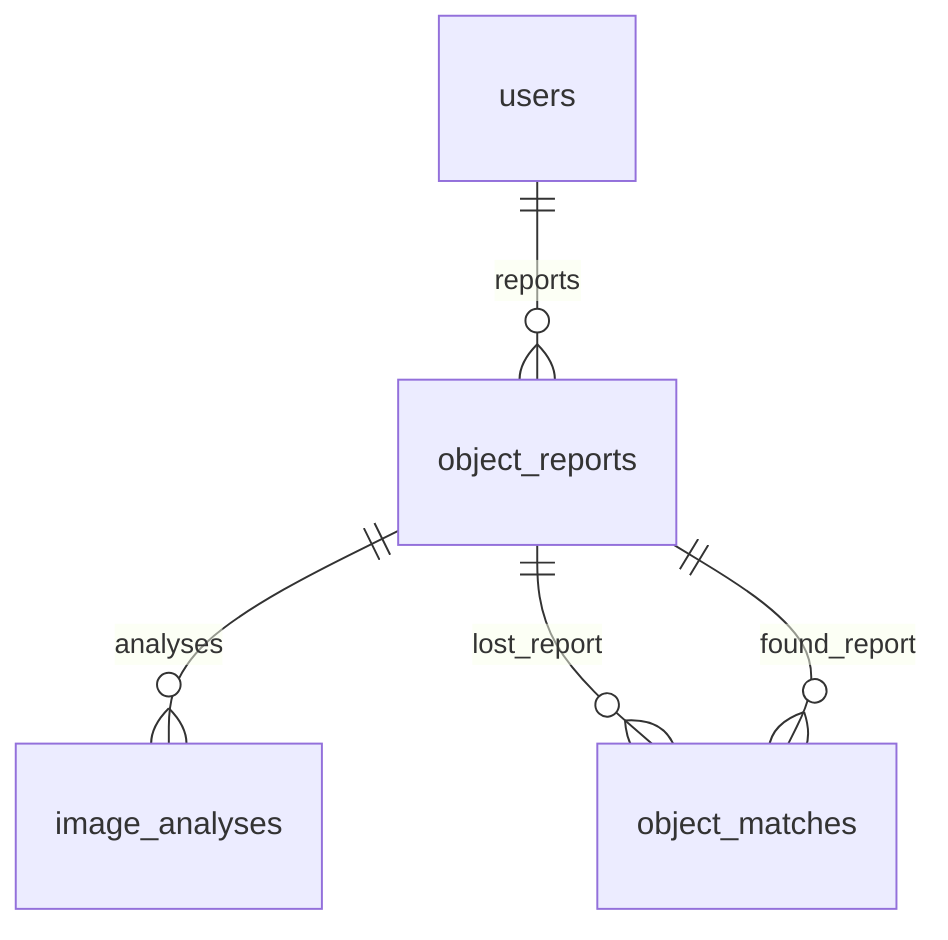

# EncuentraU AI API

API de reconocimiento visual y evaluación de coincidencias entre objetos perdidos
y encontrados, con infraestructura PostgreSQL y migraciones. Los endpoints de
análisis y coincidencias todavía no guardan datos; los endpoints persistentes se
implementarán en la siguiente fase.

## Funciones incluidas

- `GET /health`: comprueba que el servidor está disponible.
- `GET /health/database`: comprueba la conexión con PostgreSQL.
- `POST /api/v1/ai/analyze`: recibe una fotografía y una descripción.
- `POST /api/v1/matches/evaluate`: compara dos objetos y devuelve evidencias.
- Validación de JPEG, PNG y WEBP.
- Límite configurable de tamaño.
- Análisis con Gemini mediante el SDK oficial `google-genai`.
- Respuesta JSON validada con Pydantic.
- Pruebas automáticas que no consumen la API de Gemini.

## 1. Preparar el entorno

Desde la raíz del repositorio `EncuentraU_Backend`:

```bash
python -m venv .venv
```

En Windows PowerShell:

```powershell
.\.venv\Scripts\Activate.ps1
pip install -r requirements-dev.txt
```

En Linux o macOS:

```bash
source .venv/bin/activate
pip install -r requirements-dev.txt
```

## 2. Configurar Gemini

1. Crea una clave gratuita en Google AI Studio.
2. Solo si no existe `.env`, copia `.env.example` como punto de partida. Si ya
   existe, conserva su contenido y agrega manualmente las variables faltantes.
3. Reemplaza el valor de `GEMINI_API_KEY`.

El archivo `.env` está ignorado por Git y no debe publicarse.

## 3. Ejecutar

```bash
uvicorn app.main:app --reload --port 8000
```

Abre:

```text
http://127.0.0.1:8000/docs
```

En `POST /api/v1/ai/analyze`, selecciona **Try it out**, escribe la descripción,
elige una fotografía y ejecuta la petición.

## 4. Ejecutar pruebas

```bash
pytest
ruff check .
```

Las pruebas utilizan un analizador falso para verificar el endpoint y el contrato
JSON sin consumir cuota de Gemini.

## Contrato de salida

```json
{
  "object_detected": true,
  "object_type": "audifonos inalambricos",
  "category": "electronica",
  "primary_color": "negro",
  "secondary_colors": [],
  "brand": null,
  "shape": "intraurales con estuche rectangular",
  "visible_features": ["estuche negro"],
  "visible_text": [],
  "image_quality": "buena",
  "confidence": "alta",
  "requires_another_photo": false,
  "warnings": []
}
```

La confianza es orientativa. El usuario siempre podrá confirmar o corregir los
atributos antes de guardarlos.

## Motor de coincidencias

`POST /api/v1/matches/evaluate` recibe JSON con `lost` y `found`. Conserva el
contrato de entrada anterior. Los atributos de cada objeto son opcionales; si no
son comparables, se marcan como `unknown` y se excluyen del máximo evaluable.
Los valores vacíos y marcadores como `desconocido`, `sin marca` y `no visible`
tampoco son evidencia. Se rechazan campos adicionales y fechas inválidas con
HTTP 422.

Ejemplo para Postman (`Content-Type: application/json`):

```json
{
  "lost": {
    "object_type": "audífonos Bluetooth",
    "category": "electronica",
    "primary_color": "negro",
    "secondary_colors": [],
    "brand": "JBL",
    "shape": "estuche ovalado",
    "visible_features": ["audífonos intraurales", "estuche compacto", "puerto USB-C"],
    "visible_text": ["JBL"],
    "location": "Cafetería central",
    "event_date": "2026-09-01",
    "description": "Audífonos Bluetooth negros en estuche ovalado compacto."
  },
  "found": {
    "object_type": "auriculares inalámbricos",
    "category": "electronica",
    "primary_color": "negro",
    "secondary_colors": [],
    "brand": "JBL",
    "shape": "estuche ovalado",
    "visible_features": ["audífonos intraurales", "estuche compacto", "puerto USB-C"],
    "visible_text": ["JBL"],
    "location": "Cafetería central",
    "event_date": "2026-09-01",
    "description": "Audífonos inalámbricos negros en estuche ovalado compacto."
  }
}
```

El ejemplo devuelve este resumen, además de nueve `factors` y `warnings`:

```json
{
  "percentage": 100,
  "identity_percentage": 100,
  "context_percentage": 100,
  "evidence_coverage": 95.2,
  "compatible": true,
  "level": "high"
}
```

### Modelo jerárquico

La identidad aporta el 80% del resultado y el contexto aporta el 20%. Los pesos
internos de cada grupo suman 100:

| Grupo | Factor | Peso interno |
| --- | --- | ---: |
| Identidad | Tipo de objeto | 25 |
| Identidad | Categoría | 5 |
| Identidad | Color | 15 |
| Identidad | Marca | 10 |
| Identidad | Forma | 10 |
| Identidad | Rasgos visuales | 20 |
| Identidad | Descripción del objeto | 15 |
| Contexto | Lugar | 60 |
| Contexto | Fecha | 40 |

```text
identity_percentage = puntos_identidad / peso_identidad_evaluable × 100
context_percentage = puntos_contexto / peso_contexto_evaluable × 100
percentage = identity_percentage × 0,80 + context_percentage × 0,20

evidence_coverage = (peso_identidad_evaluable / 100 × 0,80
                  + peso_contexto_evaluable / 100 × 0,20) × 100
```

Un grupo sin evidencia tiene porcentaje cero; su participación no se transfiere
al otro grupo. `percentage` se redondea al entero más cercano al terminar el
cálculo. Identidad, contexto y cobertura se devuelven con hasta dos decimales.
Los puntos de cada factor se conservan con dos decimales y son los que se usan
para calcular los porcentajes de los grupos. Es una puntuación de evidencias,
no una probabilidad calibrada de que se trate del mismo objeto.

La cobertura indica cuánto del modelo pudo evaluarse, independientemente del
resultado de las comparaciones. Por ejemplo, si solo falta la marca, la
identidad tiene 90 puntos evaluables y el contexto 100: la cobertura es 92%.
Una marca distinta y legible aporta cero puntos, pero sí entra en el denominador.

Cada factor contiene `name`, `group` (`identity` o `context`), `label`, `weight`,
`evaluable_weight`, `score`, `status` y `explanation`. `weight` es su peso interno
máximo; `evaluable_weight` indica cuánto se pudo comparar. `score` representa
puntos dentro del grupo, no una contribución directa al porcentaje final.
Los estados siguen siendo `match`, `partial`, `different` y `unknown`.

### Reglas de comparación

- Las comparaciones por palabras usan intersección dividida por unión (Jaccard).
  Se normalizan mayúsculas, tildes y puntuación, y se omiten artículos y
  preposiciones. Hay equivalencias explícitas para singular/plural y variantes
  como auriculares/audífonos, Bluetooth/inalámbricos, copa/copas,
  almohadilla/almohadillas y acolchado/acolchada/acolchados/acolchadas.
- Categoría y marca requieren igualdad del texto normalizado.
- El color principal representa el 60% del factor; los conjuntos de colores
  secundarios se comparan con Jaccard para el 40% restante. Si los secundarios
  no se pueden comparar, solo se evalúan los 9 puntos del principal. Si solo
  se conocen los secundarios, se evalúan sus 6 puntos. Los componentes ausentes
  reducen la cobertura y no se registran como diferencias. Por eso el ejemplo
  anterior, sin secundarios comparables, tiene cobertura de 95,2%. Dos conjuntos
  secundarios conocidos y disjuntos generan una advertencia.
- La forma tiene su propio factor. Los rasgos y el texto visible se comparan
  como características independientes: cada una busca su mejor correspondencia
  por palabras en el otro objeto y se promedian ambas direcciones. Se eliminan
  duplicados y se conserva la simetría; juntar palabras de distintos atributos
  no equivale a describir el mismo rasgo.
- La descripción excluye los tokens de ambos lugares y palabras de reporte
  como perdí, perdido, encontré, encontrado, hallado y extraviado, con sus
  variantes. Una descripción que solo contiene esos datos queda como `unknown`.
- El lugar usa similitud de palabras. La fecha aporta 100% si es el mismo día;
  75% entre 1 y 3 días después; 50% entre 4 y 7; 25% entre 8 y 14. Un hallazgo
  anterior a la pérdida o posterior a los 14 días aporta cero y sigue siendo
  evaluable. Las fechas invertidas generan una advertencia.

### Compatibilidad y niveles

Si la similitud del tipo de objeto es menor a 0,35, `compatible` es `false`, se
añade una advertencia y el porcentaje se limita a 29, con nivel `low`. Los
porcentajes de identidad y contexto conservan sus valores para explicar el
resultado anterior al límite. El mismo lugar y fecha no pueden superar esta
regla.

Si el tipo no se puede comparar, no se afirma una incompatibilidad: `compatible`
indica ausencia de incompatibilidad conocida. La falta de tipo se muestra en
los factores, las advertencias y la cobertura. Una cobertura reducida requiere
interpretar el porcentaje con esa limitación.

Los niveles usan el porcentaje final redondeado:

- `high`: al menos 85 y compatible.
- `possible`: al menos 60 y compatible.
- `low`: cualquier otro caso.

Las pruebas de `tests/fixtures/matching/` conservan los tres cuerpos originales
obtenidos de los análisis de Gemini: mismo objeto desde otro ángulo, objeto
parecido y objeto diferente. En todos se fijó deliberadamente el mismo lugar y
la fecha `2026-10-16`. Las pruebas reproducen esas entradas sin enviar imágenes
ni consumir nuevas llamadas a Gemini.

Para comparar análisis reales, copia únicamente los atributos del objeto desde
`/api/v1/ai/analyze` y añade `location`, `event_date` y `description` del reporte.
Los metadatos `object_detected`, `image_quality`, `confidence`,
`requires_another_photo` y `warnings` no forman parte de `MatchableObject`.
Si Gemini no detecta un objeto o pide otra foto, revisa el análisis antes de
evaluar coincidencias. Las pruebas del motor usan datos controlados y no validan
el reconocimiento de fotografías reales.

## Base técnica de PostgreSQL

La infraestructura está en `app/infrastructure/database/`: base declarativa,
modelos SQLAlchemy 2, engine con psycopg 3 y fábrica de sesiones. El dominio no
importa SQLAlchemy. El engine y las sesiones se crean bajo demanda; importar la
aplicación no abre conexiones ni crea tablas automáticamente.

La dependencia `get_session` entrega una sesión por petición y siempre la cierra,
también ante excepciones. El cierre revierte trabajo sin confirmar; los futuros
casos de uso deberán decidir explícitamente cuándo hacer `commit`.

### Tablas y relaciones

| Tabla | Contenido y restricciones |
| --- | --- |
| `users` | UUID; nombre; email y código estudiantil únicos; hash de contraseña, rol, estado activo y fechas de creación/actualización. |
| `object_reports` | UUID; propietario, tipo `lost/found`, estado, atributos del objeto, descripción, lugar, fecha y característica privada. |
| `image_analyses` | UUID; reporte, proveedor, modelo, extracción JSONB, confianza y fecha de creación. |
| `object_matches` | UUID; pareja lost/found única, métricas, compatibilidad, nivel, factores JSONB, advertencias JSONB, estado y fecha de creación. |



Todos los identificadores son UUID generados por la aplicación. Las fechas de
auditoría usan timestamps con zona horaria y valor inicial del servidor.
`updated_at` se actualiza mediante SQLAlchemy al modificar un registro; una
actualización SQL externa debe mantenerlo explícitamente.

Los porcentajes están limitados a 0–100. Las métricas de identidad, contexto y
cobertura tienen dos decimales. Una pareja no puede relacionar un reporte
consigo mismo; si `compatible` es falso, el nivel debe ser `low` y el porcentaje
no puede superar 29. Las claves foráneas garantizan la existencia de los reportes;
la validación de que cada uno tenga el tipo lost/found correcto queda para los
futuros casos de uso persistentes.

No se permite borrar un usuario con reportes. Al borrar un reporte se eliminan
sus análisis y coincidencias mediante claves foráneas con `ON DELETE CASCADE`.
Los atributos visuales desconocidos y `private_feature` admiten NULL.
No hay columnas binarias ni almacenamiento de fotografías; las referencias a
imágenes se añadirán en una fase posterior.

Decisiones iniciales de estados:

- Roles: `student`, `admin`.
- Reportes: `active`, `resolved`, `cancelled`.
- Coincidencias: `pending`, `accepted`, `rejected`.
- Confianza visual: `baja`, `media`, `alta`, como en el contrato de Gemini.

La unicidad de email y código se aplica sobre sus valores almacenados. La
normalización de email y la política de roles se completarán con autenticación.

### Configuración local

Agrega manualmente estas variables a tu `.env` existente, usando `.env.example`
como referencia y conservando las variables de Gemini:

- `POSTGRES_DB`
- `POSTGRES_USER`
- `POSTGRES_PASSWORD`
- `POSTGRES_PORT`
- `DATABASE_URL`

El ejemplo contiene únicamente valores de muestra. `DATABASE_URL` debe apuntar
al mismo usuario, contraseña, puerto y base definidos para Docker, con el esquema
`postgresql+psycopg`. También se acepta `postgresql` y se selecciona psycopg 3.
Si la contraseña contiene caracteres reservados, debe codificarse para una URL.

La URL se guarda como `SecretStr`, se oculta en la representación de Settings y
los errores de configuración no imprimen sus valores. El engine desactiva el
registro de SQL y oculta parámetros. No imprimas la URL ni la configuración
expandida de Compose.

Antes de iniciar el servicio, comprueba que Docker y su daemon estén disponibles:

```powershell
docker version
docker compose version
docker compose config --quiet
docker compose up -d --wait
python -m alembic upgrade head
```

El Compose usa PostgreSQL 17, publica el puerto únicamente en `127.0.0.1`, obtiene
variables de `.env`, incorpora un healthcheck y conserva los datos en el volumen
nombrado `postgres_data`. Las variables de inicialización de PostgreSQL solo se
aplican al crear un volumen vacío; cambiarlas después no modifica las credenciales
de una base existente. La imagen y su configuración se describen en la
[documentación oficial de PostgreSQL para Docker](https://hub.docker.com/_/postgres).

La revisión inicial de Alembic es `0001_postgresql_foundation`. Crea las cuatro
tablas, índices, claves y restricciones; no depende de `create_all` ni de las
credenciales incluidas en un archivo versionado. Alembic utiliza la configuración
en memoria y no escribe `DATABASE_URL` en `alembic.ini`.

Si PowerShell bloquea la activación del entorno, usa directamente
`.\.venv\Scripts\python.exe` en lugar de `python`, sin cambiar la política del
sistema. Reinicia Uvicorn después de configurar las variables.

### Disponibilidad y pruebas

`GET /health/database` ejecuta `SELECT 1`: devuelve HTTP 200 con
`{"status":"ok","database":"postgresql"}` o HTTP 503 con
`{"detail":"La base de datos no está disponible."}`. Si `DATABASE_URL` no está
configurada, devuelve 503; `/health`, `/api/v1/ai/analyze` y
`/api/v1/matches/evaluate` mantienen su funcionamiento independiente.

```powershell
python -m ruff format .
python -m ruff check .
python -m pytest
```

Las pruebas no cargan `.env`. Las pruebas unitarias de metadatos y restricciones
usan SQLite en memoria, y también generan SQL de PostgreSQL sin conectarse.
Para ejecutar la integración real, define `TEST_DATABASE_URL` únicamente en el
entorno del proceso, apuntando a una base de prueba PostgreSQL, y ejecuta:

```powershell
python -m pytest -m postgresql
```

La integración crea un esquema con UUID, aplica y revierte migraciones, vuelve
a aplicarlas, verifica ausencia de cambios pendientes de Alembic, prueba
restricciones y JSONB y comprueba el health real. Solo elimina el esquema que
acaba de crear. Requiere permisos para crear esquemas en esa base de prueba.
Si la variable no está definida, esa prueba se omite de forma explícita.

En esta fase no se implementan CRUD, login/JWT, almacenamiento de imágenes,
reclamaciones ni chat. La persistencia aún no está conectada a los endpoints de
análisis y coincidencias.
